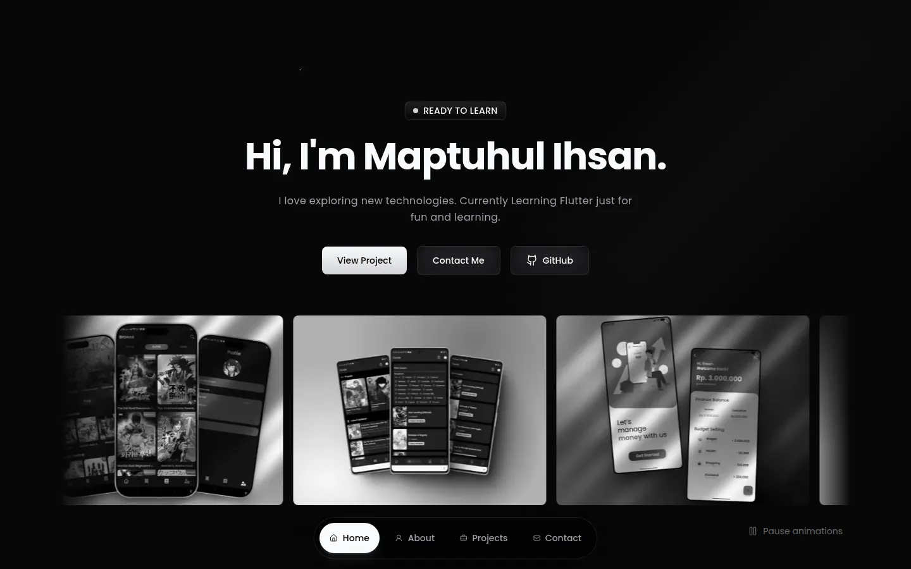

# MMI Portfolio

Personal portfolio of Muhamad Maptuhul Ihsan, a Flutter developer who is still learning by building.

**Live site:** [www.mpsan.my.id](https://www.mpsan.my.id/)



## Tech stack

- SvelteKit 2 and Svelte 5 (runes)
- TypeScript
- Tailwind CSS v4
- Lenis for smooth scrolling
- `@sveltejs/enhanced-img` for AVIF and WebP images
- Deployed on Vercel with `@sveltejs/adapter-vercel`

## Getting started

Requires Node.js 24 and pnpm 10.

```sh
pnpm install
pnpm dev
```

| Command        | Description                         |
| -------------- | ----------------------------------- |
| `pnpm dev`     | Start the development server        |
| `pnpm build`   | Create a production build           |
| `pnpm preview` | Preview the production build        |
| `pnpm check`   | Run type checks with `svelte-check` |
| `pnpm lint`    | Run Prettier and ESLint             |
| `pnpm format`  | Format the code with Prettier       |

## Project structure

```text
src/
├── lib/
│   ├── assets/        Images processed at build time
│   ├── components/    Page sections and shared UI
│   └── data/          Profile, project, skill, and site content
├── routes/
│   ├── +layout.svelte Shared shell, fonts, and smooth scrolling
│   ├── +layout.ts     Prerender setting
│   ├── +page.svelte   Home page
│   ├── +error.svelte  Error and 404 page
│   └── layout.css     Tailwind theme tokens and global styles
static/                Favicons, Open Graph image, robots.txt, sitemap.xml
```

To add or change a project, edit `src/lib/data/projects.ts`. A project with no links shows no buttons.
